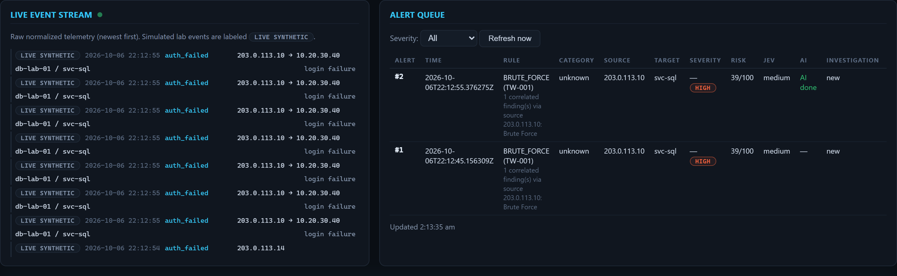
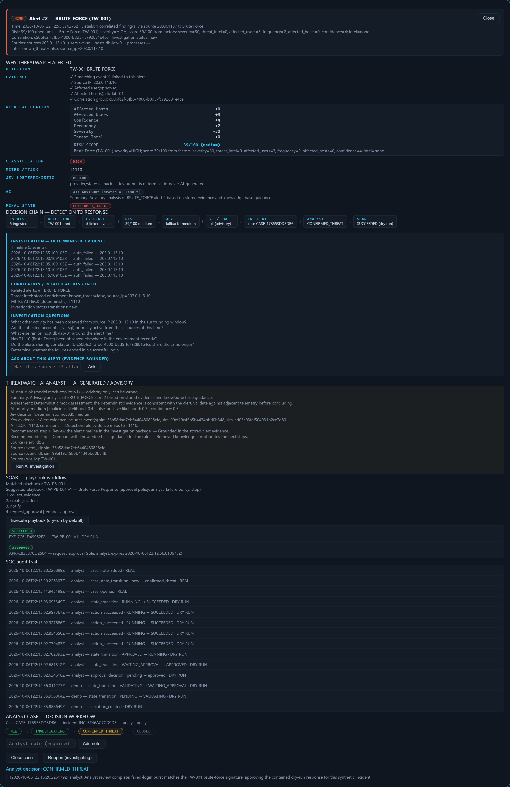
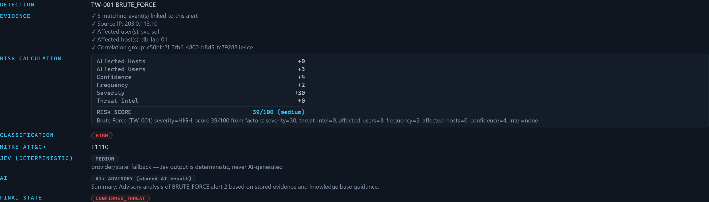
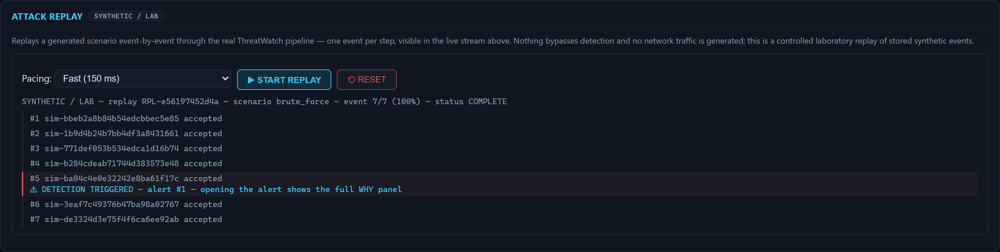
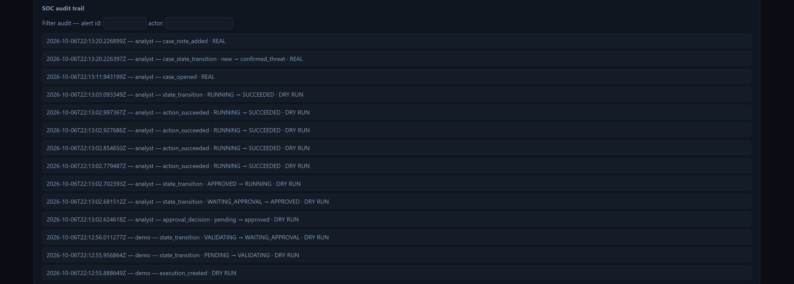

# ThreatWatch

**Security Operations & Automation Platform**

ThreatWatch is a local, offline SOC platform built to demonstrate the full
security-operations workflow end to end: events are ingested and normalized,
analyzed by a deterministic detection engine with MITRE ATT&CK mapping,
correlated, scored with an explainable risk model, prioritized by the advisory
**Jev** decision layer, investigated with evidence packages, RAG knowledge
retrieval, and an optional advisory AI copilot, responded to through an
approval-gated **SOAR** playbook engine in dry-run mode, and recorded in a
complete audit trail — all visible in a single SOC command-center dashboard.

It is a portfolio project, not an enterprise deployment: it processes only
synthetic or user-supplied events, never generates real network traffic, and
never executes destructive actions.

## SOC Pipeline

```
Security Events (JSONL collector | bearer-authenticated POST /api/ingest)
        ↓
Normalization        validated SecurityEvent schema (event_model.py)
        ↓
Detection            deterministic rules engine, 10 rules, ATT&CK mapped
        ↓
Correlation          indicator grouping + duplicate suppression
        ↓
Threat Intelligence  offline CSV indicators, typed enrichment
        ↓
Risk Scoring         explainable 0–100 weighted factors
        ↓
Jev                  advisory structured decision (fallback-safe)
        ↓
Investigation
├── Evidence model        redacted timeline + typed entities
├── Threat Intelligence   stored enrichment + feed matches
├── MITRE ATT&CK          deterministic technique mapping
├── Threat Hunting        whitelisted, parameterized queries
└── RAG                   local knowledge retrieval (SQLite vector store)
        ↓
AI Analysis          advisory copilot (mock | live | disabled), grounded + validated
        ↓
Incident             deterministic alert/correlation linkage
        ↓
SOAR                 playbooks → human approval gate → dry-run response
        ↓
Audit                every transition, decision, note, and action recorded
```

Every stage is real code in this repository — the dashboard reads from the
running engines, never from hard-coded values.

## Key Capabilities

| Area | What is implemented |
|---|---|
| **Detection engineering** | 10 deterministic rules declared once in `rules.py` (id, severity, threshold, window, confidence, ATT&CK mapping), implemented in `detections.py`; individually disableable and tunable via env vars |
| **Event ingestion** | JSONL file collector with durable cursor + authenticated HTTP ingestion (dedup, replay vs conflict semantics, 1 MiB bound) |
| **Normalization** | Versioned event schema with validation of timestamps, IPs, ports, and metadata |
| **Threat intelligence** | Typed indicator classification (IP/domain/URL/hash), confidence, offline CSV feed |
| **Correlation** | Indicator-based grouping with merged evidence and cooldown suppression |
| **Risk scoring** | Deterministic 0–100 factor breakdown with plain-language explanation |
| **Jev decision layer** | Advisory priority / likelihoods / investigation flag / attack category; fail-safe fallback |
| **Investigation** | Evidence packages, bounded redacted timelines, typed entities, analyst questions, lifecycle state machine |
| **Threat hunting** | Whitelisted, parameterized, bounded queries (`GET /api/hunt`) with fail-closed filters |
| **RAG** | Local knowledge base (rules, ATT&CK, intel, guides), deterministic chunking, embedding provider seam, SQLite vector store, bounded retrieval |
| **AI copilot** | Advisory, evidence-grounded investigation, alert explanation, triage, reports, recommendations, AI-assisted hunting; strict output validation + anti-fabrication grounding; provider abstraction (mock / openai-compatible / disabled) |
| **SOAR** | Versioned playbooks, declarative triggers, allowlisted action providers, approval workflow, mandatory dry-run default, idempotency, fail-closed adapters |
| **Analyst workflow** | Alert → WHY panel → decision chain → case management (notes, confirm/false-positive, close) → HTML investigation report |
| **Attack replay** | 15 synthetic SOC scenarios replayed event-by-event through the real pipeline |
| **Auditability** | Every transition, decision, note, and action written to audit tables; secrets redacted throughout |

## Detection Engineering

Every rule is declared once in [`rules.py`](rules.py) (id, name, stable alert
code, severity, threshold, window, confidence, tags, ATT&CK mapping) and
implemented in [`detections.py`](detections.py). Rules are independently
testable, individually disableable via `RULE_<ID>_ENABLED=false`, and tunable
via `RULE_<ID>_THRESHOLD`, `RULE_<ID>_WINDOW`, and `RULE_<ID>_SEVERITY`.

| Rule ID | Name | Default severity | MITRE ATT&CK |
|---|---|---|---|
| `TW-001` | Brute Force | HIGH | T1110 |
| `TW-002` | Port Scan | MEDIUM | T1046 |
| `TW-003` | Traffic Spike | LOW | — |
| `TW-004` | Password Spraying | HIGH | T1110.003 |
| `TW-005` | Suspicious PowerShell | HIGH | T1059.001, T1027 |
| `TW-006` | Suspicious Command Line | MEDIUM | T1059 |
| `TW-007` | Suspicious Process Activity | MEDIUM | T1059.004 |
| `TW-008` | Suspicious Privilege Activity | HIGH | T1548.003, T1078.003 |
| `TW-009` | Suspicious Persistence Activity | HIGH | T1053.003, T1543.002 |
| `TW-010` | Possible Data Exfiltration | MEDIUM | T1048.003 |

Brute force and spraying share one windowed state store and are deliberately
distinguished: one account hammered = brute force; many distinct accounts from
one source = spraying. Rules consume normalized events supplied through the
API/JSONL contract — real source collection is not implemented.

## Risk Scoring

Risk is a deterministic, explainable 0–100 weighted sum
([`risk.py`](risk.py)): severity (30), threat-intel confidence (25), distinct
affected users (15, saturating), event frequency (15, saturating), affected
hosts (10, saturating), detector confidence (5). Every alert stores its full
factor breakdown and a plain-language explanation; bands are low (<35),
medium, high (≥60), critical (≥80). The dashboard shows each factor's
contribution so the score is never a black box.

## Jev Decision Layer

**Jev is advisory.** After risk scoring, ThreatWatch can ask the Jev model
five bounded questions about an alert (priority, malicious likelihood,
false-positive likelihood, investigation flag, attack category). Responses are
validated against whitelists; failures fall back safely
(`priority=medium`, `investigation_required=true`, `jev_status=fallback`).
Jev never blocks ingestion or detection, never executes actions, and is fully
optional — deterministic detection, risk scoring, alerting, and persistence
run unchanged with Jev disabled. The dashboard labels Jev output as
deterministic and shows its state (FALLBACK / ACTIVE / DISABLED) honestly.

## AI / RAG

- **RAG foundation**: local knowledge sources (detection rules, ATT&CK
  technique docs, intel CSV, investigation guides, historical incidents,
  project docs) are redacted, chunked deterministically, embedded, and stored
  in a SQLite vector store; retrieval is bounded top-k with validated filters.
- **Advisory AI copilot**: `AIInvestigationEngine` chains alert → investigation
  package → retrieval → LLM → strict JSON validation → grounding check. The
  model sees only a bounded, pre-redacted view; invented references are
  dropped and reported; malformed output never reaches an analyst.
- **Surfaces**: alert explanation, triage, 13-section investigation report,
  recommendations, AI-assisted hunting (NL → validated filters — the model
  never generates SQL or touches the database).
- **Provider abstraction**: `disabled` (default), `mock` (deterministic,
  offline, used by all tests and the demo), `openai-compatible` (any
  OpenAI-compatible endpoint; keys via env, never logged).
- **Honesty by design**: every AI panel is labeled `AI-GENERATED / ADVISORY`,
  and the WHY panel distinguishes `AI: DISABLED`, `AI: NOT RUN — provider: …`,
  and `AI: MOCK/LIVE (ADVISORY)`. AI never overrides deterministic detection,
  risk, Jev, or the investigation lifecycle, and cannot execute anything.

## Threat Hunting

`GET /api/hunt` runs whitelisted, parameterized queries over stored events:
exact filters (`src_ip`, `dst_ip`, `event_type`, `file_hash`), redacted
substring filters (`user`, `host`, `process`, `command`, `domain`, `url`),
ISO-8601 time ranges, and linkage (`alert_id`, `correlation_id`, `technique` —
quote-delimited so `T1110` never matches `T1110.003`). Unknown filters and
unsafe values fail closed with 400; results are ordered, paginated (≤ 500),
and secret-redacted. AI-assisted hunting translates natural language into the
same validated filter catalog.

## SOAR

A safe, auditable, approval-aware playbook framework — the deterministic
engine controls execution, never the AI layer.

- **Playbooks** are versioned JSON definitions, fail-closed validated at
  definition time. Built-ins: `TW-PB-001` Brute Force Response (analyst
  approval) and `TW-PB-002` Suspicious PowerShell Triage.
- **Dry-run is mandatory by default**: actions return
  `would_execute` + `expected_effect` with no external changes. Destructive
  adapters (host isolation, account action, firewall, email, ticketing) are
  mock/dry-run only and fail closed — no shell, SQL, or URL execution exists.
- **Human approval gates**: gated executions park in `WAITING_APPROVAL`
  before anything runs; approvals are authenticated human decisions with a
  TTL — never inferred from AI output. State machine:
  `PENDING → VALIDATING → WAITING_APPROVAL → APPROVED → RUNNING → SUCCEEDED`
  (plus validation-failure, rejection, expiry, cancellation, timeout paths).
- **Idempotency**: one execution per (playbook, version, alert, correlation);
  repeats return the existing execution, never a duplicate run.
- **Audit**: every transition and action writes a redacted audit row;
  evidence packages are frozen and immutable at execution start.

## Analyst Investigation

```
Alert → Investigate → Evidence → Decision → Incident → SOAR → Close → Audit
```

The dashboard consolidates this into one analyst view:

- **WHY THREATWATCH ALERTED** — detection, evidence checkmarks (source IP,
  users, hosts, correlation group), the full risk-factor table, classification,
  MITRE ATT&CK, Jev state, AI state, and final state — all read from stored
  data, with disabled/fallback states shown honestly.
- **Decision Chain** — nine visible stages (EVENTS → DETECTION → EVIDENCE →
  RISK → JEV → AI/RAG → INCIDENT → ANALYST → SOAR), each showing its actual
  current state.
- **Case management** — start investigation, add notes, confirm threat or mark
  false positive (decision note required), close; every decision and note is
  an audit event.
- **Investigation report** — one click exports a clean dark-themed HTML
  report (detection, entities, timeline, threat intel, ATT&CK, Jev, AI,
  analyst decision, SOAR, audit) that clearly distinguishes DETERMINISTIC,
  AI-GENERATED, JEV, and ANALYST DECISION content.

## Attack Replay

The Simulation Lab generates 15 synthetic SOC scenarios (11 malicious,
3 benign, 1 designed false positive). **Attack Replay** feeds a generated
scenario's stored events through the *real* ingestion → detection →
correlation → intel → risk → Jev pipeline one event at a time, with visible
pacing — nothing bypasses detection, and no network traffic is generated.
The panel is clearly labeled `SYNTHETIC / LAB`, every streamed event is
labeled `LIVE SYNTHETIC`, and the moment a rule actually fires the replay
shows `DETECTION TRIGGERED`. Full SOC validation (15 scenarios) compares
expected vs actual results and never hides designed false positives.

## Quick Demo

```powershell
.\demo.ps1
```

The launcher:

- generates a **cryptographically secure ephemeral console token**
  (.NET RNG) and keeps it only in the running process environment —
  nothing is written to tracked files or committed;
- uses the **mock AI provider** (fully offline) by default;
- creates a **fresh local demo database** in `%TEMP%`;
- starts ThreatWatch, prints the dashboard URL and token, and opens the
  browser.

Paste the printed token into the **Console token** field and follow the
10-minute demo below. Stop the server with `Stop-Process -Id <printed PID>`
(or close the terminal); the demo database can be deleted from `%TEMP%`
any time.

Normal secure mode is unchanged: without the launcher, ThreatWatch requires
you to set `INGEST_TOKEN` yourself — see [Manual Setup](#manual-setup).

## 10-Minute SOC Demo

1. Run `.\demo.ps1`
2. Open the SOC Command Center.
3. Start **Brute Force Attack Replay**.
4. Watch synthetic events enter the pipeline (`LIVE SYNTHETIC`).
5. Observe **TW-001** detection (`DETECTION TRIGGERED`).
6. Open the alert.
7. Inspect evidence (timeline, source IP, user, host).
8. Inspect the risk score (factor-by-factor breakdown).
9. Inspect MITRE **T1110**.
10. Review the **Decision Chain**.
11. Review the **Jev** state (deterministic fallback).
12. Review the **AI/RAG** investigation (advisory, grounded).
13. Start analyst investigation (open case).
14. Add an analyst note.
15. Confirm the threat (decision note required).
16. Run the **SOAR** workflow (execute playbook, dry-run).
17. Approve the action at the human approval gate.
18. Review the dry-run response (`SUCCEEDED · DRY RUN`).
19. Review the **audit trail** (workflow + case events).
20. Export the **investigation report** (HTML).
21. Close the case — then `⟲ RESET SOC DEMO` to clear lab state
    (rules, playbooks, configuration, and the knowledge base survive).

## Manual Setup

Requires Python 3.12/3.13 and [uv](https://docs.astral.sh/uv/).

```bash
uv sync --locked --group dev
```

Generate your own secure token (≥ 32 characters) and set it in the
environment — never in a file the repo tracks:

```powershell
# PowerShell
$env:INGEST_TOKEN = "<your-generated-token>"     # e.g. (python -c "import secrets; print(secrets.token_urlsafe(32))")
$env:DB_FILE = "$env:TEMP\tw_soc.sqlite"
$env:AI_LLM_PROVIDER = "mock"
uv run python app.py
```

```bash
# Bash
export INGEST_TOKEN="<your-generated-token>"
export DB_FILE="$TEMP/tw_soc.sqlite"
export AI_LLM_PROVIDER=mock
uv run python app.py
```

Open `http://127.0.0.1:5000/` and paste the token into the console field.
`INGEST_TOKEN` protects every state-changing endpoint (simulation, replay,
reset, validation, SOAR actions, case/incident/report writes, AI runs);
read-only endpoints stay unauthenticated for loopback use. A missing token
disables ingestion (HTTP 503); invalid credentials return 401.

### Configuration

All configuration is environment-based (placeholders only — never commit real
values; see [.env.example](.env.example)):

| Variable | Default | Meaning |
|---|---|---|
| `DB_FILE` | `db.sqlite` | SQLite database path |
| `INGEST_TOKEN` / `INGEST_TOKEN_FILE` | unset | Bearer token (≥ 32 chars); configure only one |
| `PORT` | `5000` | Local server port |
| `THREAT_INTEL` | `threat_intel.csv` | Demo intel CSV (`indicator,tag[,confidence[,source]]`) |
| `DETECTION_WINDOW` / `BRUTE_FORCE_THRESHOLD` | `60` / `5` | Brute-force tuning |
| `RULE_<ID>_ENABLED/_THRESHOLD/_WINDOW/_SEVERITY` | per rule | Per-rule overrides |
| `CORRELATION_ENABLED` / `CORRELATION_COOLDOWN_SECONDS` | `true` / `300` | Suppression control |
| `JEV_ENABLED` | `false` | Enable the Jev advisory decision provider |
| `JEV_API_KEY` | unset | Jev bearer key; never logged |
| `INVESTIGATION_AI_ENABLED` | `false` | Attach the offline AI perspective to packages |
| `KNOWLEDGE_DB_FILE` | `knowledge.sqlite` | Vector-store path |
| `EMBEDDING_PROVIDER` / `EMBEDDING_DIMENSIONS` / `EMBEDDING_MODEL` | `disabled` / `256` / `BAAI/bge-small-en-v1.5` | Retrieval embedding control |
| `AI_LLM_PROVIDER` | `disabled` | `disabled` / `mock` / `openai-compatible` |
| `AI_LLM_ENDPOINT` / `AI_LLM_MODEL` | OpenAI chat-completions URL / `gpt-4o-mini` | Live provider target |
| `AI_LLM_API_KEY` / `AI_LLM_API_KEY_FILE` | unset | LLM key; never logged |
| `AI_LLM_TIMEOUT_SECONDS` / `AI_LLM_MAX_OUTPUT_TOKENS` / `AI_LLM_TEMPERATURE` | `20` / `800` / `0.2` | LLM request bounds |
| `AI_INVESTIGATION_TOP_K` / `AI_CACHE_ENABLED` | `5` / `false` | Retrieval size / evidence-hash cache |

## Security

- **Environment-based secrets** — no hard-coded credentials anywhere; tokens
  and keys are read from the environment (or a token file) and never logged,
  stored in results, or echoed to the UI. `.env` files are git-ignored.
- **Bearer authentication** — every state-changing endpoint (ingestion,
  simulation, replay, reset, SOAR, cases, AI runs) requires the token; the
  demo launcher's token is ephemeral and never persisted.
- **Advisory AI** — the copilot explains and recommends; it cannot execute
  actions, bypass approval, or override deterministic decisions.
- **Human approval gates** — gated SOAR actions stop at
  `WAITING_APPROVAL` until an authenticated human decides.
- **Dry-run SOAR** — dry-run is the default for every execution; destructive
  adapters fail closed, and no adapter executes shell commands, SQL, or URLs.
- **Fail-closed validation** — unknown filters, malformed playbooks, bad
  transitions, and unsafe values are rejected, not coerced.
- **Audit logging** — detection-to-response, every decision, note, and
  action is audited with redacted, bounded payloads.
- **Synthetic only** — the console generates no real attack traffic and
  contacts no external systems.

## Testing

```
591 passed
```

`uv run pytest -q` — fully offline. Coverage includes event validation and
deduplication, database creation/migration, the detection rules and threat-intel
enrichment, correlation and risk, API authentication and error handling,
evidence/redaction, investigation packages and lifecycle, hunting (including
injection attempts), the vector store and retrieval, the AI copilot (provider
seam, response validation, grounding/anti-fabrication, prompt-injection as
data, reports, recommendations, AI hunting), SOAR (playbook validation,
triggers, dry-run, approvals, state machine, idempotency, audit redaction),
the SOC console, attack replay, analyst cases, decision explanations, and the
investigation report.

## Project Structure

```
app.py                  Flask app: dashboard API, ingestion, SOC console, SOAR, AI, cases, replay
rules.py / detections.py  Rule registry + deterministic detection engine
event_model.py          Versioned event validation/normalization
correlator.py / risk.py / decision.py   Correlation, risk scoring, Jev seam
evidence.py / investigation.py          Evidence model + investigation packages
hunting.py              Bounded threat-hunting queries
knowledge.py / retrieval.py / vector_store.py / embeddings.py   RAG layer
llm_provider.py / ai_investigation.py / ai_hunting.py   Advisory AI copilot
playbook.py / actions.py / soar.py      SOAR framework
soc_simulation.py / soc_replay.py       Scenario lab + event-by-event replay
soc_cases.py / soc_report.py            Analyst cases + HTML investigation report
database.py             Authoritative SQLite schema (v5)
templates/ static/      SOC command-center dashboard
tests/                  591 offline tests
demo.ps1                One-command local presentation launcher
docs/screenshots/       Dashboard screenshots
```

## Screenshots

> Captured from the running SOC Command Center (`docs/screenshots/`).

| View | What it shows |
|---|---|
|  | **SOC Command Center** — status pills, counters, automation workers, severity/MITRE/source bars, live event stream |
|  | **Alert Queue** — rule, correlation, source/target, severity, risk, Jev, AI, investigation state |
|  | **Alert Investigation** — entities, evidence timeline, investigation questions, advisory AI panel with RAG sources |
|  | **WHY THREATWATCH ALERTED** — detection, evidence, risk factors, classification, MITRE, Jev, AI, final state |
|  | **Decision Chain** — nine stages from events to SOAR with live states |
|  | **Attack Replay** — event-by-event replay through the real pipeline, `SYNTHETIC / LAB` |
|  | **SOAR Defense Center** — playbooks, dry-run executions, approval gate, incidents |
|  | **Audit Trail** — workflow + case events, redacted and bounded |

## Limitations

Honest constraints of the current implementation:

- Only simulator/JSONL events and authenticated event POSTs are ingested;
  real log collection is not implemented. The PowerShell, process, privilege,
  persistence, and DNS rules fire only on events supplied through the event
  contract.
- The live-LLM provider (`openai-compatible`) is implemented and unit-tested
  with mocks but has not been browser-validated against a real endpoint;
  browser E2E used the mock provider. The live Jev provider is likewise
  implemented but not browser-validated.
- SOAR adapters are intentionally simulated/dry-run; there are no real
  integrations (host isolation, ticketing, email) in this project.
- The architecture is a local, single-user console over a single-file SQLite
  deployment — no RBAC, no multi-node processing; keep it on loopback.
- Threat intelligence is a small static CSV with exact-match enrichment; there
  is no feed lifecycle or history.
- The `local-hash` embedding is a deterministic term-overlap substitute, not a
  transformer model; semantic retrieval requires the optional fastembed
  provider and reindexing.
- The console is operator tooling over the same database: polling is bounded
  intervals (no websockets), and state (suppression, validation history,
  replays) is per-database.
